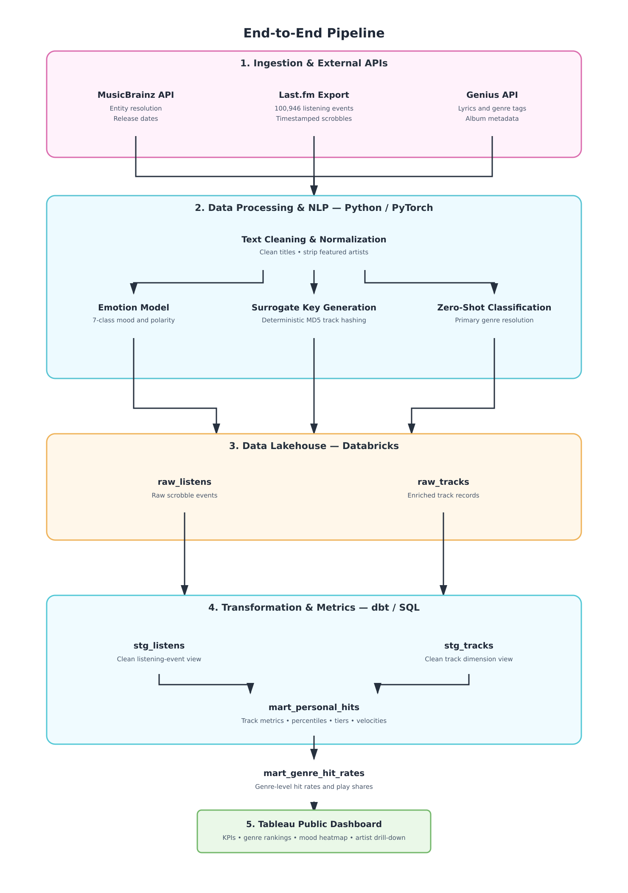
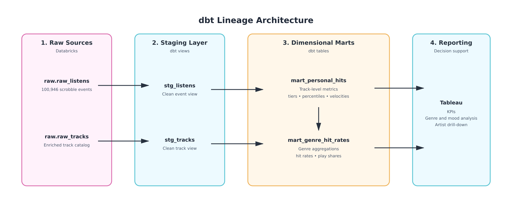
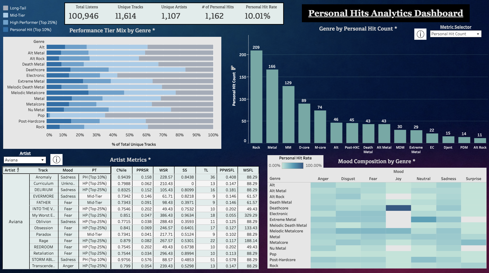

# Personal Music Analytics Dashboard

[View Interactive Tableau Dashboard](https://public.tableau.com/app/profile/rish.jain/viz/PersonalMetalMusicAnalyticsDashboard/Dashboard#1)

## Project Overview

This is a personal project with a business analytics twist analyzing my personal music tastes over the past few years (May 2020 through September 2026). This pipeline goes from extracting raw data, cleaning it, running NLP models on it, storing the data in a data warehouse, and visualizing my calculated personal hits and listening habits in a Tableau dashboard.

## Data Sources

- **Last.fm Scrobble History**: 100,946 scrobbles (listens) from May 2020 through September 2026 containing timestamps for each listen (export: https://mainstream.ghan.nl/export.html)
- **Genius API**: Lyrics, primary genre tags, and album metadata extracted for unique track analysis
- **MusicBrainz API**: Entity resolution, standardized recording identifiers, and official song/album release dates

## Methods

### 1. Metric Selection
- The following core metrics and dimensions were engineered:
    - **Total Listens (TL)**: Total play count for each unique track across the 6-year span
    - **Catalog Play Percentile (C%ile)**: Relative percentile rank of each song across all 11,614 tracks in the catalog
    - **Performance Tier (PT)**: Four-tiered segmentation based on catalog play percentile:
        - *Personal Hit (Top 10%)*: $\ge 90\text{th}$ percentile ($\ge 25$ listens).
        - *High Performer (Top 25%)*: $75\text{th} - 90\text{th}$ percentile.
        - *Mid-Tier*: $40\text{th} - 75\text{th}$ percentile.
        - *Long-Tail*: $< 40\text{th}$ percentile.
    - **Weeks Since Release (WSR)**: Total number of weeks since the first time the song was played in the catalog
    - **Weeks Since First Listen (WSFL)**: Total number of weeks since the first time the song was ever played
    - **Plays Per Week Since Release (PPRSR)**: Replay velocity of song from when it was first released (`TL / max(WSR, 1.0)`)
    - **Plays Per Week Since First Listen (PPWSFL)**: Replay velocity of song from when it was first discovered/listened to (`TL / max(WSFL, 1.0)`)
    - **Sentiment Score (SS) & Mood**: Hugging Face transformer model classification confidence and top emotion category (*anger, disgust, fear, joy, neutral, sadness, surprise*)
    - **Primary Genre**: Primary genre of the song as determined by zero-shot classification and 4-genre tag parsing

### 2. Modeling Method
- **Emotion & Sentiment Inference**: Utilized the `j-hartmann/emotion-english-distilroberta-base` fine-tuned RoBERTa transformer model to classify song lyrics into 7 distinct emotional categories (*anger, disgust, fear, joy, neutral, sadness, surprise*) along with high-level polarity (*positive, negative, neutral*).
- **Zero-Shot Genre Resolution**: Applied zero-shot classification and curated tag parsing to resolve primary musical genres while filtering out non-genre tags (e.g., countries, languages, "acoustic", "concept album").
- **Personal Hit Classification Rule**:
    - The following percentile equation was used to rank tracks across the listening catalog:
    $$\text{Catalog Play Percentile} = \frac{\text{Rank}(\text{Total Listens}) - 1}{N - 1}$$
    - Any track ranking at or above the 90th percentile ($\ge 25$ total listens) was classified as a **Personal Hit** (`is_personal_hit = 1`). This threshold isolates the top 10% of catalog tracks that represent core favorites and drive disproportionate listening share.

### 3. ETL Pipeline Overview
- The ETL pipeline ingests raw Last.fm scrobble dumps, resolves track and artist entities against MusicBrainz, and scrapes song lyrics and tag data using the Genius API.
- Python pipelines clean text formatting, strip featured artist suffixes, handle missing release dates, and generate deterministic surrogate MD5 keys from normalized artist, track, and album names
- Transformer inference runs in batched PyTorch pipelines to score emotion probabilities on cleaned lyrics.
- Cleaned and enriched datasets are partitioned into normalized staging tables (`stg_tracks`, `stg_listens`) and modeled downstream into dimensional business marts using SQL and dbt on Databricks.

### 4. Warehouse Schema
- The data warehouse follows a star schema centered around `stg_listens` (fact table of 100,946 scrobble events) and `stg_tracks` (dimension table of 11,614 enriched tracks).
- Dimension and fact models feed into analytics marts:
    - **`mart_personal_hits`**: Track-level table containing total listens, catalog percentiles, performance tiers, weekly replay velocities (PPRSR, PPWSFL), release/first listen dates, and mood classifications.
    - **`mart_genre_hit_rates`**: Genre-level aggregation calculating total tracks, personal hit counts, personal hit rates, total plays, and hit play shares.

### 5. Minimum Sample Thresholds
- To avoid small-sample distortion, the Artist Metrics table only lists artists individually if they have ≥15 distinct tracks played; artists below this threshold are grouped under “Other” (with their individual tracks still viewable, ranked by play count) to prevent one or two high-play tracks from an under-sampled artist from appearing statistically equivalent to an artist with a diverse and deeper listening catalog. This creates a more meaningful representation of an artist's contribution to my overall music listening.
- The genre-level charts separately show the top 15 genres with the most total listens; this is a display limit rather than a sample-size issue.

## Results & Dashboard
- The Tableau dashboard provides an executive and interactive look at my personal music consumption, content tiers, genre preferences, and emotions:

- **Key Dashboard Components**:
  1. **Executive KPI Strip**: Summary scorecard displaying Total Listens (`100,946`), Unique Tracks (`11,614`), Unique Artists (`1,107`), Personal Hits (`1,162`), and Personal Hit Rate (`10.01%`).
  2. **Top 15 Genres by Personal Hit Count**: Vertical bar chart featuring an interactive **Metric Selector** parameter (*Personal Hit Count, Personal Hit Rate, Genre Hit Plays, Genre Total Plays, Hit Play Share, Total Tracks*), highlighting leaders such as Rock (209 hits), Metal (166), Melodic Metalcore (129), and Deathcore (89).
  3. **Mood Composition by Genre**: Heatmap matrix mapping primary genres against 7 emotional categories (*anger, disgust, fear, joy, neutral, sadness, surprise*) colored by density and hit rate.
  4. **Performance Tier Mix by Genre**: 100% horizontal stacked bar chart illustrating catalog depth across all 4 tiers (*Long-Tail, Mid-Tier, High Performer, Personal Hit*).
  5. **Artist Metrics Table**: Granular track-level cross-tab with interactive Artist filtering (artists with $\ge 15$ tracks played) detailing mood, performance tier, catalog percentile, weekly play velocities, and listen counts.

## Key Findings
- **The Pareto Principle in Music Consumption**: While 11,614 unique tracks were played, the top 10% (1,162 Personal Hits with $\ge 25$ plays) accounted for approximately 49.6% of all total listens, demonstrating a power-law distribution in long-term music engagement.
- **Genre Conversion Disparities**: While broad genres like Rock and Metal produced the highest number of personal hits, more niche heavy subgenres like Melodic Death Metal, Djent, and Extreme Metal have significantly higher personal hit rates relative to total tracks explored.
- **Cathartic Mood Dominance**: Anger, fear, and sadness make up a majority of the mood classifications, especially on metalcore and deathcore hits; this means that cathartic and high-intensity emotions fall into replay values.
- **Discovery Velocity vs. Enduring Hits**: Comparing weekly play rates highlights the difference between songs binged heavily right after finding them and all-time favorites played steadily year after year.

## Why Personal Data Instead of Population Data
I chose to build this analysis on my own listening history rather than population-level data because individual-level behavioral data is exactly what business analytics teams work with in practice. Individual metrics are seen as a prototype of customer metrics in real life to see what metrics resonate with the customer base, as from there patterns can be determined to build more generalized, metrics, models, and dashboards. Using my own data allowed me to build and validate an entire BI pipeline end-to-end with full visibility into ground truth, which is rarely found in public datasets. This project also helped me gain insight into what songs and genres resonated with me to additionally give me a sense of how to potentially identify a hit song in my books.

## What Can Be Classified as a Hit
When a new song gets released, it can't be classified as a personal hit immediately even if it acquires a lot of listens at first and has high emotional relatability in terms of anger, fear, etc; the track could die down later. This is parallel to business analytics as it is difficuly to determine the value of anything when it first releases. A new product feature can have an initial spike in usage and can fade quickly, but metrics that matter in the long run like retention, repeat usage, and lifetime value take time to look at. This concept is seen in this project specifically through the PPRSR (Plays Per Week Since Release) and PPWSFL (Plays Per Week Since First Listen) metrics. The listening velocity can only be determined over time through percentile rankings (top 10% by total listens, ≥25 plays) rather than early to accumulate plays relative to the rest of the catalog.

## Conclusion

This project utilized core concepts of business analytics: setting meaningful metrics, validating them against real behavioral data, and separating short-term from long-term value. By treating my own listening history as a stand-in for a customer engagement dataset, I was able to build a complete BI pipeline (Python, dbt, Databricks, Tableau). This allowed me to apply the same analytical techniques companies would use to evaulate content performance and/or customer segements. Sentiment analysis through NLP, percentile-based segmentation, catalog composition analysis, and mood/genre cross-tabulation provided a deeper understanding into not just **what** music was listened to but **why**.

The findings such as the Pareto principle for engagement and the role of emotional intensity in replay behavior display patterns that show up constantly in real business data: a small number of products, customers, or even content drives a disproportionate part of the value, and it is important to look deeper into surface-level popularity to determine what actually retains engagement over time.

## **Tech Stack**
- Python (Pandas, PyTorch, Transformers, Requests)
- Hugging Face DistilRoBERTa (`j-hartmann/emotion-english-distilroberta-base`)
- dbt (Data Build Tool)
- Databricks/SQL
- MusicBrainz API & Genius API
- Last.fm (Scrobble Export)
- Tableau Public
